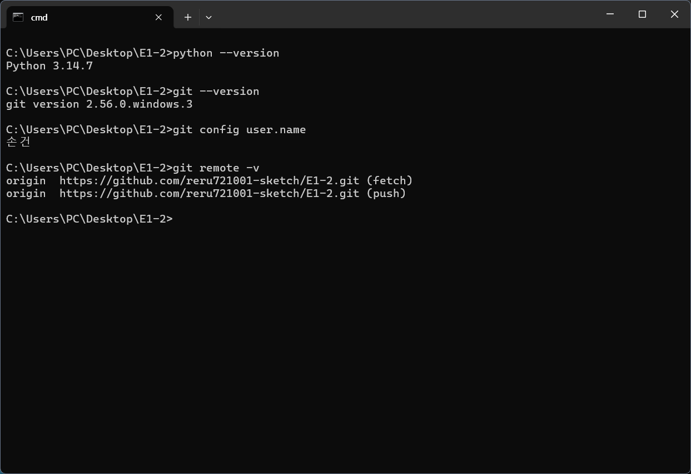
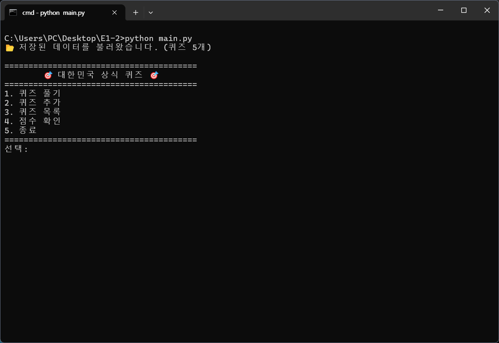
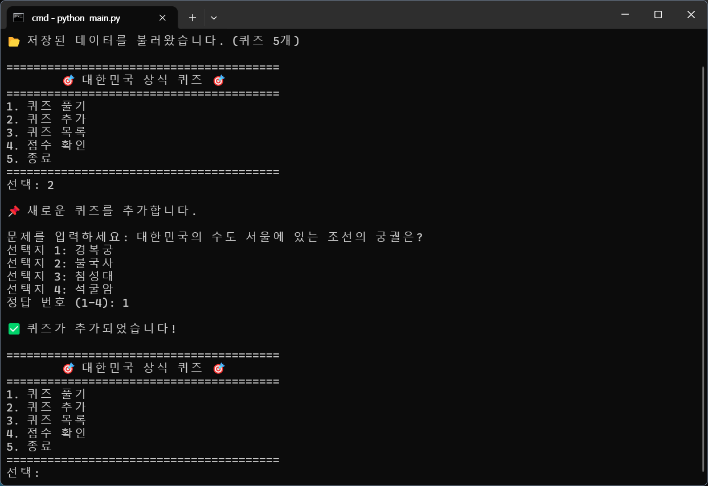
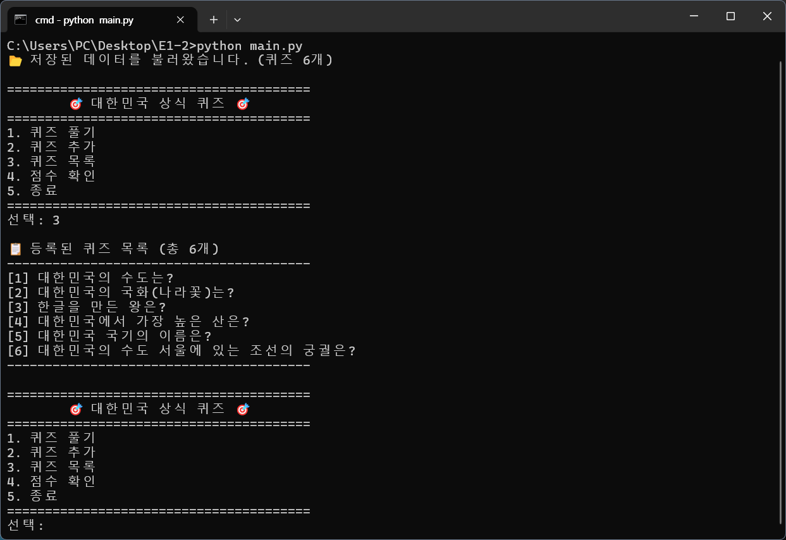
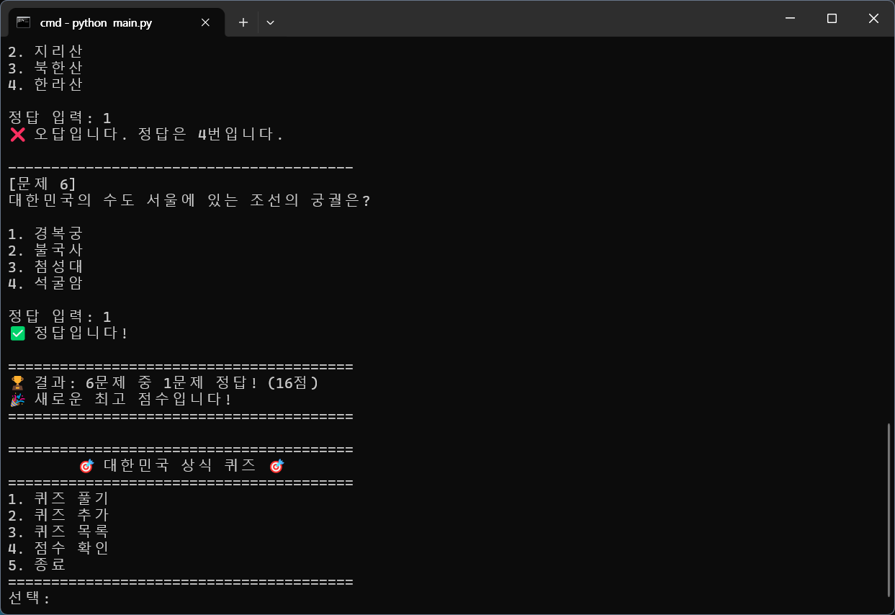
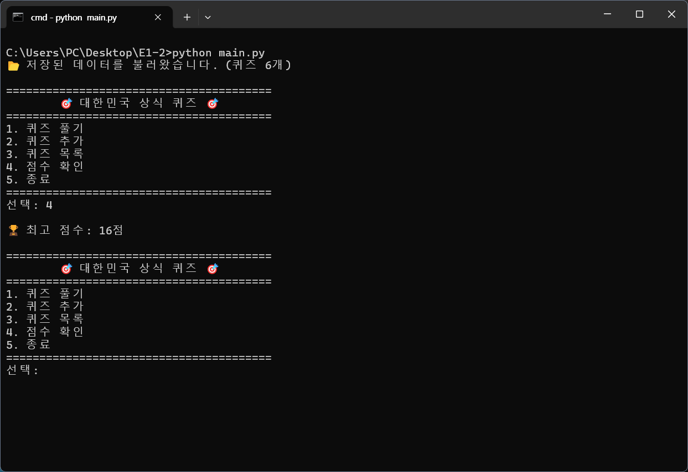
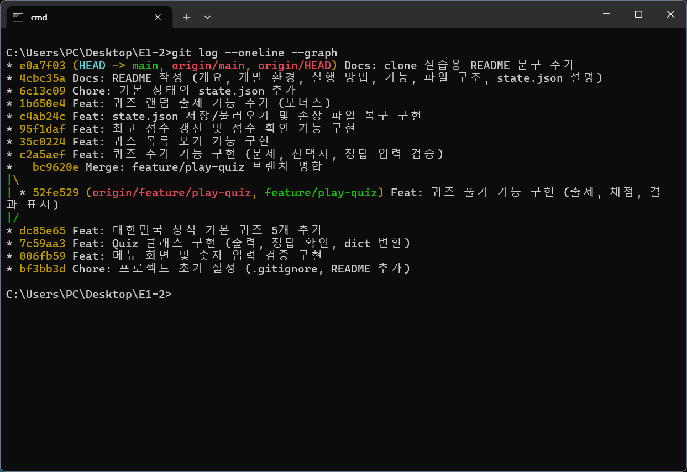

# 🎯 대한민국 상식 퀴즈 게임

## 1. 프로젝트 개요
터미널에서 실행하는 Python 콘솔 퀴즈 게임입니다.
메뉴에서 번호를 선택해 퀴즈를 풀고, 새 퀴즈를 추가하고, 목록과 최고 점수를 확인할 수 있습니다.
퀴즈와 최고 점수는 `state.json` 파일에 저장되어 프로그램을 다시 실행해도 유지됩니다.

## 2. 개발 환경
| 구분 | 내용 |
|---|---|
| OS | Windows 11 |
| Python | 3.14.7 (3.10 이상 필요, 표준 라이브러리만 사용) |
| Git | 2.56.0 |
| 에디터 / 터미널 | VSCode / Windows Terminal (cmd) |

## 3. 퀴즈 주제 선정 이유
주제는 **대한민국 기초 상식**으로 정했습니다.
이번 미션의 목표는 퀴즈 내용보다 Python 문법, 클래스 설계, 파일 저장, Git 사용법을 직접 익히는 것이라고 생각했습니다.
그래서 누구나 알 만하고 정답을 확인하기 쉬운 주제를 골라, 문제를 만드는 시간은 줄이고 기능 구현에 더 집중했습니다.

## 4. 실행 방법
```bash
git clone https://github.com/reru721001-sketch/E1-2.git
cd E1-2
python main.py
```
(macOS / Linux에서는 `python3 main.py`)

## 5. 기능 목록
| 메뉴 | 기능 | 설명 |
|---|---|---|
| 1 | 퀴즈 풀기 | 등록된 퀴즈를 **랜덤 순서**로 출제하고 정답/오답과 최종 점수(100점 만점)를 보여줍니다. 최고 점수를 넘으면 갱신합니다. |
| 2 | 퀴즈 추가 | 문제, 선택지 4개, 정답 번호를 입력받아 새 퀴즈를 등록하고 파일에 저장합니다. |
| 3 | 퀴즈 목록 | 등록된 퀴즈의 문제 목록을 번호와 함께 보여줍니다. |
| 4 | 점수 확인 | 최고 점수를 보여줍니다. 아직 풀지 않았다면 안내 메시지를 출력합니다. |
| 5 | 종료 | 데이터를 저장하고 프로그램을 종료합니다. |

### 입력 및 예외 처리
- 입력값의 앞뒤 공백을 제거한 뒤 처리합니다.
- 빈 입력, 숫자가 아닌 입력(`abc`), 범위 밖 숫자(메뉴 `9`, 정답 `0`)는 안내 후 다시 입력받습니다.
- `Ctrl+C`(KeyboardInterrupt)나 입력 종료(EOFError)가 발생하면 저장 후 안전하게 종료합니다.
- `state.json`이 없으면 기본 퀴즈 5개로 시작하고, 손상되었으면 안내 후 기본 퀴즈로 복구합니다.

### 보너스
- 랜덤 출제: `random.shuffle()`로 출제 순서를 섞습니다. (원본 목록 순서는 유지)

## 6. 파일 구조
```
E1-2/
├── main.py        # 프로그램 시작점, QuizGame 클래스 (메뉴, 풀기, 추가, 목록, 점수, 저장/불러오기)
├── quiz.py        # Quiz 클래스 (퀴즈 한 문제: 출력, 정답 확인, dict 변환)
├── quiz_data.py   # 기본 퀴즈 5개를 만드는 함수
├── state.json     # 퀴즈 목록과 최고 점수 저장 파일
├── README.md      # 프로젝트 설명서
├── .gitignore     # Git이 무시할 파일 목록
└── docs/
    └── screenshots/  # 실행 화면 스크린샷
```

### 클래스 구조
| 클래스 | 역할 | 주요 메서드 |
|---|---|---|
| `Quiz` | 퀴즈 한 문제 | `display()`, `is_correct()`, `to_dict()`, `from_dict()` |
| `QuizGame` | 게임 전체 관리 | `run()`, `play_quiz()`, `add_quiz()`, `show_quizzes()`, `show_score()`, `load()`, `save()` |

## 7. 데이터 파일 설명 (`state.json`)
- **경로**: 프로젝트 루트 (`main.py`와 같은 폴더)
- **역할**: 퀴즈 목록과 최고 점수를 저장해, 프로그램을 다시 실행해도 데이터가 유지되게 합니다.
- **인코딩**: UTF-8 (한글이 그대로 저장되도록 `ensure_ascii=False` 사용)
- **저장 시점**: 퀴즈 추가 시, 최고 점수 갱신 시, 프로그램 종료 시(Ctrl+C 포함)

### 스키마
| 키 | 자료형 | 설명 |
|---|---|---|
| `quizzes` | list | 퀴즈 목록 |
| `quizzes[].question` | str | 문제 |
| `quizzes[].choices` | list[str] | 선택지 4개 |
| `quizzes[].answer` | int | 정답 번호 (1~4) |
| `best_score` | int 또는 null | 최고 점수 (100점 만점, 아직 풀지 않았으면 null) |

### 예시
```json
{
    "quizzes": [
        {
            "question": "대한민국의 수도는?",
            "choices": ["부산", "서울", "대구", "인천"],
            "answer": 2
        }
    ],
    "best_score": 80
}
```
> clone한 저장소에서 추가한 문장입니다. (clone/pull 실습)


## 8. 실행 화면 (Windows 11, Windows Terminal)

### 개발 환경


### 메뉴


### 퀴즈 추가


### 퀴즈 목록
다시 실행해도 추가한 퀴즈가 유지됩니다.



### 퀴즈 풀기 (랜덤 출제)


### 최고 점수


### Git 커밋 기록


## 9. Git 작업 기록
- 저장소: https://github.com/reru721001-sketch/E1-2
- 커밋 수: 이 섹션 작성 시점 기준 **16개** (일반 커밋 15개 + 병합 커밋 1개), 이후 README 보강 커밋 추가
- 브랜치: `main`, `feature/play-quiz` (퀴즈 풀기 기능을 별도 브랜치에서 개발 후 `--no-ff`로 병합)
- 확인 명령: `git log --oneline --graph`, `git rev-list --count HEAD`

### 커밋 그래프 (`git log --oneline --graph`)
```
* c321aab Feat: 손상 파일 백업(state.json.bak) 및 안전한 저장 구현
* 07f99b0 Docs: 실행 화면 스크린샷 추가 및 README에 첨부
* e0a7f03 Docs: clone 실습용 README 문구 추가
* 4cbc35a Docs: README 작성 (개요, 개발 환경, 실행 방법, 기능, 파일 구조, state.json 설명)
* 6c13c09 Chore: 기본 상태의 state.json 추가
* 1b650e4 Feat: 퀴즈 랜덤 출제 기능 추가 (보너스)
* c4ab24c Feat: state.json 저장/불러오기 및 손상 파일 복구 구현
* 95f1daf Feat: 최고 점수 갱신 및 점수 확인 기능 구현
* 35c0224 Feat: 퀴즈 목록 보기 기능 구현
* c2a5aef Feat: 퀴즈 추가 기능 구현 (문제, 선택지, 정답 입력 검증)
*   bc9620e Merge: feature/play-quiz 브랜치 병합
|\
| * 52fe529 Feat: 퀴즈 풀기 기능 구현 (출제, 채점, 결과 표시)
|/
* dc85e65 Feat: 대한민국 상식 기본 퀴즈 5개 추가
* 7c59aa3 Feat: Quiz 클래스 구현 (출력, 정답 확인, dict 변환)
* 006fb59 Feat: 메뉴 화면 및 숫자 입력 검증 구현
* bf3bb3d Chore: 프로젝트 초기 설정 (.gitignore, README 추가)
```

### 브랜치 생성 및 병합 과정
그래프에서 `|/`는 브랜치가 갈라진 지점, `|\`는 다시 합쳐진 지점입니다.
`dc85e65`(기본 퀴즈 추가) 이후 `feature/play-quiz` 브랜치를 만들어 `52fe529`(퀴즈 풀기)를 개발했고, `bc9620e`에서 `main`에 병합했습니다.

```bash
git checkout -b feature/play-quiz        # 브랜치 생성 및 이동
git add main.py
git commit -m "Feat: 퀴즈 풀기 기능 구현 (출제, 채점, 결과 표시)"
git push -u origin feature/play-quiz     # 브랜치를 원격에 업로드
git checkout main                        # main으로 이동 (이 시점의 main에는 퀴즈 풀기 기능이 없음)
git merge --no-ff feature/play-quiz -m "Merge: feature/play-quiz 브랜치 병합"
git push
```
`--no-ff` 옵션을 사용해 병합 커밋을 남겼기 때문에, 그래프에서 브랜치 작업 기록이 구분되어 보입니다.

### clone / pull 실습
```bash
git clone https://github.com/reru721001-sketch/E1-2.git E1-2-clone   # 다른 폴더로 복제
cd E1-2-clone
# README.md 끝에 문장 추가
git add README.md
git commit -m "Docs: clone 실습용 README 문구 추가"
git push
cd ..\E1-2
git pull                                  # Fast-forward로 e0a7f03 반영
```
`7. 데이터 파일 설명` 끝의 인용문(`> clone한 저장소에서 추가한 문장입니다.`)이 이 실습으로 추가된 문장입니다.

### 사용한 Git 명령
| 명령 | 사용한 곳 |
|---|---|
| `git init` | 저장소 초기화 |
| `git add` / `git commit` | 모든 기능 단위 커밋 |
| `git push` | 매 커밋 후 원격 반영, 브랜치 업로드 (`-u`) |
| `git checkout` | 브랜치 생성(`-b`) 및 `main` 복귀 |
| `git merge` | `feature/play-quiz` 병합 |
| `git clone` | `E1-2-clone` 폴더로 복제 |
| `git pull` | clone 폴더에서 push한 변경을 원래 폴더로 반영 |

## 10. 커밋 규칙
### 커밋 단위
- **기능 하나 = 커밋 하나**: 메뉴, Quiz 클래스, 기본 데이터, 풀기, 추가, 목록, 점수, 저장/불러오기, 랜덤 출제를 각각 따로 커밋했습니다.
- 커밋하기 전에 `python main.py`로 해당 기능이 동작하는지 확인합니다. (실행되지 않는 상태로 커밋하지 않음)
- 문서 변경과 코드 변경은 커밋을 나눕니다.

### 메시지 형식
```
<타입>: <무엇을 했는지 한국어로 요약> (필요하면 괄호 안에 세부 내용)
```

| 타입 | 의미 | 예시 |
|---|---|---|
| `Feat` | 새 기능 추가 | `Feat: 퀴즈 추가 기능 구현 (문제, 선택지, 정답 입력 검증)` |
| `Docs` | 문서 수정 | `Docs: README 작성 (개요, 실행 방법, 기능, 파일 구조, state.json 설명)` |
| `Chore` | 설정, 데이터 정리 등 기능 외 작업 | `Chore: 기본 상태의 state.json 추가` |
| `Merge` | 브랜치 병합 | `Merge: feature/play-quiz 브랜치 병합` |
| `Fix` | 버그 수정 (필요 시 사용) | `Fix: 정답 번호 범위 검사 오류 수정` |
